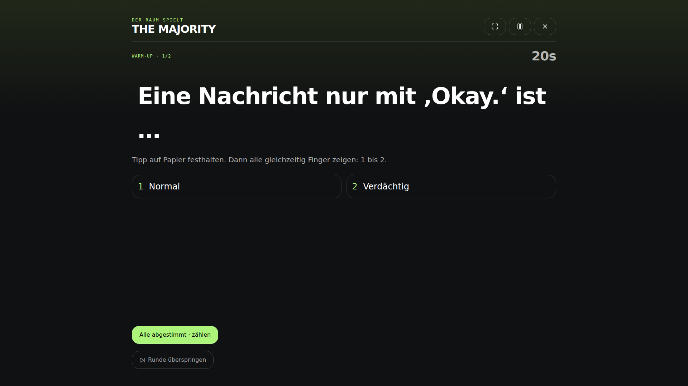
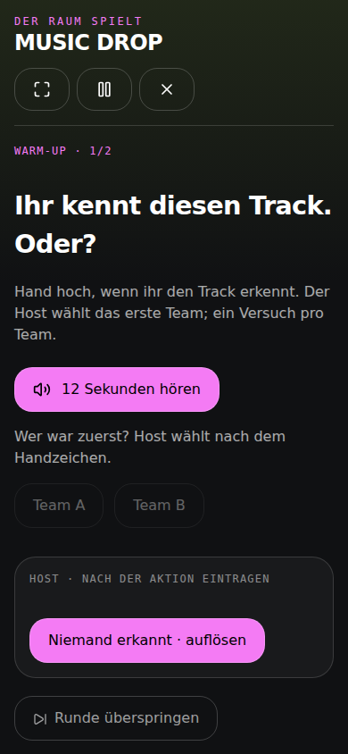

# GANG MODE — Premium-2026-Implementierung

Stand: 26.10.2026. Bestehendes Projekt Game, Repository MasterMP88/gamevalut.

## Umfang und Architektur

Das Repo enthält **16 spielbare GANG-Titel** sowie den weiterhin gesperrten TIME-DROP-Prototyp. Die sechs priorisierten Couch-Titel wurden zuerst umgesetzt; HOT SEAT, TEAM CHAOS und CHAIN REACTION ergänzen die gemeinsame Bühne. Sieben weitere Titel behalten private Geräte dort, wo Geheimhaltung, Kreativität oder Medien sie rechtfertigen.

- Kanonische Verträge: `packages/gang-core/src/experience.ts`.
- Öffentliche Raumspiele: `couch.ts` + `src/components/gang/CouchPlayer.tsx`.
- Private/Netzwerkspiele: `runtime.ts`, `missions.ts`, `online.ts`, `GangPlayer.tsx`, `GangRoom.tsx`.
- Erweiterte Inhalte: `edition-three.ts`; vorhandene IDs bleiben stabil.
- App-Core ausschließlich mit `node scripts/vendor-cores.mjs` erzeugen.

## Verbindliche Spielweise

| Game | Empfehlung | Personen | Content-Pool | Richtdauer |
|---|---|---:|---:|---:|
| THE MAJORITY | BIG SCREEN / Couch; ONE PHONE gleichwertig | 3–99 | 68 | 6–12 Min. |
| WHO'S THAT? | BIG SCREEN / Couch; ONE PHONE gleichwertig | 3–99 | 74 | 5–10 Min. |
| THE LINE | BIG SCREEN / Couch; ONE PHONE gleichwertig | 4–99 | 62 | 5–10 Min. |
| BAD ANSWERS ONLY | BIG SCREEN / Couch; ONE PHONE gleichwertig | 3–99 | 66 | 6–12 Min. |
| MUSIC DROP | BIG SCREEN / Couch; ONE PHONE mit App-Wechsel | 2–99 | Eigene Musik-App via DJ; Audiodateien optional / 30 Voting-Prompts | 8–16 Min. |
| PANIC BUTTON | BIG SCREEN / Couch; ONE PHONE gleichwertig | 2–99 | 62 | 5–10 Min. |
| HOT SEAT | BIG SCREEN / Couch; ONE PHONE gleichwertig | 3–20 | 92 | 6–14 Min. |
| TEAM CHAOS | BIG SCREEN / Couch; ONE PHONE gleichwertig | 6–99 | 48 | 8–16 Min. |
| CHAIN REACTION | BIG SCREEN / Couch; ONE PHONE gleichwertig | 3–99 | 62 | 5–10 Min. |
| UNDERCOVER | EVERYONE IN; TV optional als Hybrid | 4–30 | 66 | 8–20 Min. |
| SECRET MISSIONS | EVERYONE IN; TV optional als Hybrid | 3–30 | 122 | 20–60 Min. |
| BLUFF | EVERYONE IN; TV optional als Hybrid | 3–20 | 54 | 8–18 Min. |
| PHOTO HUNT | EVERYONE IN; TV optional als Hybrid | 3–30 | 60 | 8–15 Min. |
| DRAW THIS | EVERYONE IN; TV optional als Hybrid | 3–30 | 68 | 8–16 Min. |
| ONE OF YOU | EVERYONE IN; TV optional als Hybrid | 4–30 | 60 | 8–16 Min. |
| AFTER DARK | EVERYONE IN; TV optional als Hybrid | 2–20 | 64 | 8–18 Min. |

Die Richtdauer beschreibt ein einzelnes Spiel. Der Director plant 15/30/60 Minuten oder Open End mit konkreten Rundenzahlen; kürzere Mix-Episoden sind möglich. Zeitangaben sind Schätzungen, weil Diskussion, Zählen und menschliches Entscheiden reale Zeit benötigen.

## Gemeinsame UX und Replay-Regeln

- Schnellstart: Game → Gruppengröße/Modus → Ready → eine Regel → Play. Kein Name/Beitritt für jede Person in der Couch-Gruppe; ab fünf Personen automatische Teams. Start unter 30 Sekunden ist das Ziel bei vorhandenem Material, keine gemessene Zusage für Audioimport oder Netzwerkbeitritt.
- Couch-Zustände: Ready → Explain → Play → Reveal → Score/Reaction → Transition → Finale. Secret ist bei Papier-Prognosen eine Handlung im Raum, kein öffentlicher Bildschirmzustand. Private Spiele verwenden die vorhandenen private/predict/answer/vote/perform/react/reveal/score-Phasen.
- Warm-up und Peak werden sichtbar angekündigt. Zwei bis zwölf Couch-Runden, separate Finalhinweise und höchstens ein Encore; erneutes Spielen erzeugt ein neues Deck. Ein Zwei-Runden-Mix komprimiert bewusst auf Warm-up und Finale.
- Ergebnisformulare erst nach der Aktion. Große Typografie und mindestens 48px große Controls; TV-Vollbild, Tastaturfokus, Escape/Pause und Exit-Dialog. Hintergrundwechsel pausiert den Couch-Timer.
- Skip vergibt null Punkte. Frühzeitiges Ende behält bereits aufgelöste Ergebnisse genau einmal. Unvollständige Runden erzeugen keinen erfundenen Sieger.
- Keine Wiederholung innerhalb der Session: eigener harter Ausschluss, getrennt vom Langzeitverlauf. Neue Inhalte zuerst, nach Erschöpfung ältere Inhalte bevorzugt; Reihenfolge mit Seed variiert.
- Verlauf enthält Inhalts-IDs und Zeitpunkte, keine Rollen, Antworten oder Personennamen. Die vorhandene Account-History-Anbindung bleibt verwendbar; Gäste verwenden lokalen Verlauf. Keine neue kostenpflichtige KI-Auswahl.
- Gruppengröße 2–4: einzelne Personen; 5–8: zwei Teams; 9–15: drei; 16–30: vier; 31–99: sechs Sektoren. Spielspezifische Mindest-/Höchstgrenzen gelten zusätzlich. Sprecher wechseln. Das ist keine Simulation von 99 persönlichen Handy-Zügen.
- Director berücksichtigt verfügbare Geräte, TV, Vibe, gewählte Energie, Zeit, Fähigkeiten und bisherigen Spieleverlauf. „Gemeinsames Gerät“ schließt private Games aus; ausdrücklich gewählte Einzelgeräte bleiben erhalten. Energie ist eine ehrliche Gruppenauswahl, keine behauptete passive Emotionserkennung.

## THE MAJORITY

**Core Fantasy:** Du kennst die Leute. Aber kennst du ihren nächsten absurden Konsens?

**Beste Spielweise:** BIG SCREEN / Couch, alternativ ONE PHONE. Die Everyone-In-Variante bleibt ausdrücklich auswählbar.

**10-Sekunden-Regel:** Tippt gemeinsam verdeckt auf die Mehrheit. Alle stimmen gleichzeitig mit Fingern ab. Richtiger Tipp: ein Punkt.

**Loop:** Offensichtliche Alltagsentscheidung; ein Probedurchgang. → Team-Tipp vor dem Finger-Vote, danach kurze Verteidigung der Minderheit. → Überraschende Mehrheiten werden sichtbar, ohne einzelne Stimmen bloßzustellen.

**Finale:** Doppelt oder gar nicht: letzter Tipp zählt zwei. Alternative: Gegen den Strom: tippt auf die kleinste besetzte Antwortgruppe. Danach optional genau ein Encore.

**Wertung / Interaktion:** Ein Punkt je richtiger Team-Prognose; Finale doppelt. Gleichstand: alle betroffenen Antworten zählen. Minderheitsfinale zählt nur tatsächlich besetzte Optionen. Aussetzen ohne Punkte.

**Private/Public-Grenze:** Tipp vor dem Vote auf Papier festlegen. Keine privaten Daten auf dem TV.

| Gruppengröße | Konkrete Mechanik |
|---|---|
| 2–4 | Einzeltipps, keine Teams nötig. |
| 5–8 | Zwei Teams beraten kurz. |
| 9–15 | Drei Teams tippen; alle stimmen. |
| 16–30 | Vier Teams tippen, ein Zähler pro Bereich. |
| 31–99 | Sechs Sektoren; Captains melden nur Summen. |

**Replay:** 68 Karten/Aufgaben, harte Session-Ausschlüsse und längerfristige Inhalts-History. Die genannten Finalvarianten sind teils neue Wertungen, teils moderierte Spielauflagen; keine versteckte automatische Spracherkennung.

**Technische Prüfung:** Core-Matrix über alle unterstützten Größenbänder; Browser-Durchläufe auf 390/1440/1920px mit zwei Runden, Encore, Skip, Finale und Neustart.

## WHO'S THAT?

**Core Fantasy:** Der Raum verleiht dir einen Titel, den du nie beantragt hast.

**Beste Spielweise:** BIG SCREEN / Couch, alternativ ONE PHONE. Die Everyone-In-Variante bleibt ausdrücklich auswählbar.

**10-Sekunden-Regel:** Drei, zwei, eins: alle zeigen. Die meistgenannte Person bekommt den Titel – und zehn Sekunden für ihr Statement.

**Loop:** Ein harmloser, schmeichelhafter Titel. → Mit jedem Titel wächst eure Galerie. → Die Nominierten dürfen in einem Satz widersprechen.

**Finale:** Die letzte Preisverleihung. Alternative: Dankesrede: genau fünf Wörter. Danach optional genau ein Encore.

**Wertung / Interaktion:** Ein Titelpunkt je gewählter Nominierung; geteilte Titel möglich. Keine erfundenen Stimmzahlen. Titelgalerie bewahrt den konkreten Rundenprompt auch nach frühem Abschluss/Encore.

**Private/Public-Grenze:** Keine geheime Stimme versprochen; Zeigen ist öffentlich. Aussetzen erlaubt.

| Gruppengröße | Konkrete Mechanik |
|---|---|
| 2–4 | Alle sind nominiert. |
| 5–8 | Zwei Teams nominieren wechselnde Vertreter. |
| 9–15 | Je Team eine wechselnde Nominierung. |
| 16–30 | Vier wechselnde Teamvertreter; Beratung im Team. |
| 31–99 | Sechs Sektoren nominieren wechselnde Vertreter. |

**Replay:** 74 Karten/Aufgaben, harte Session-Ausschlüsse und längerfristige Inhalts-History. Die genannten Finalvarianten sind teils neue Wertungen, teils moderierte Spielauflagen; keine versteckte automatische Spracherkennung.

**Technische Prüfung:** Core-Matrix über alle unterstützten Größenbänder; Browser-Durchläufe auf 390/1440/1920px mit zwei Runden, Encore, Skip, Finale und Neustart.

## THE LINE

**Core Fantasy:** Ihr seid euch sicher, wie ihr tickt – bis jemand ganz am anderen Ende steht.

**Beste Spielweise:** BIG SCREEN / Couch, alternativ ONE PHONE. Die Everyone-In-Variante bleibt ausdrücklich auswählbar.

**10-Sekunden-Regel:** Der Raum ist eure Skala. Positioniert euch, friert ein, dann sprechen zwei weit entfernte Positionen. Sitzenbleiben und Finger zeigen geht genauso.

**Loop:** Eine einfache Skala ohne Wettbewerb. → Erst schweigend positionieren, dann zwei Perspektiven hören. → Positionen dürfen nach einer guten Begründung wechseln.

**Finale:** Silent Line: kein Wort bis zum Freeze. Alternative: Spiegelrunde: erklärt eine andere Position fair. Danach optional genau ein Encore.

**Wertung / Interaktion:** Keine Sieger oder Persönlichkeitspunkte. Der Wert liegt in Perspektivwechsel und Reaktion. Sitzende Teilnahme mit Fingern ist gleichwertig.

**Private/Public-Grenze:** Keine richtigen Persönlichkeitswerte; keine erfundenen Genauigkeitspunkte.

| Gruppengröße | Konkrete Mechanik |
|---|---|
| 2–4 | Ab vier; eine Linie. |
| 5–8 | Eine Linie im Raum. |
| 9–15 | Drei Bereiche oder Sitzskala. |
| 16–30 | Vier kleine Linien gleichzeitig. |
| 31–99 | Sechs Sektoren statt einer 99er-Schlange. |

**Replay:** 62 Karten/Aufgaben, harte Session-Ausschlüsse und längerfristige Inhalts-History. Die genannten Finalvarianten sind teils neue Wertungen, teils moderierte Spielauflagen; keine versteckte automatische Spracherkennung.

**Technische Prüfung:** Core-Matrix über alle unterstützten Größenbänder; Browser-Durchläufe auf 390/1440/1920px mit zwei Runden, Encore, Skip, Finale und Neustart.

## BAD ANSWERS ONLY

**Core Fantasy:** Du wirst für die schlechteste Idee im Raum gefeiert.

**Beste Spielweise:** BIG SCREEN / Couch, alternativ ONE PHONE. Die Everyone-In-Variante bleibt ausdrücklich auswählbar.

**10-Sekunden-Regel:** Teams haben kurz Zeit für eine herrlich falsche Antwort. Nacheinander raushauen. Applaus entscheidet, zwei Punkte für den Sieger.

**Loop:** Freie Antwort, kein Leistungsdruck. → Pitch, trockene Erklärung und Werbeslogan wechseln sich ab. → Jedes Team bekommt dieselbe kurze Bühne; niemand tippt Romane.

**Finale:** Fünf Wörter. Kein sechstes. Alternative: Verkauft eure Antwort wie ein Luxusprodukt. Danach optional genau ein Encore.

**Wertung / Interaktion:** Zwei Punkte je Siegerteam nach Applaus; geteilte Sieger möglich. Finale vier. Der Host entscheidet mit dem Raum, kein vorgetäuschter Applaus-Sensor.

**Private/Public-Grenze:** Couch-Antworten sind laut; anonyme Texte bleiben eine Everyone-In-Variante.

| Gruppengröße | Konkrete Mechanik |
|---|---|
| 2–4 | Ab drei, einzeln antreten. |
| 5–8 | Zwei Teams; Sprecher wechseln. |
| 9–15 | Drei Teams entwickeln parallel. |
| 16–30 | Vier Teams, je ein kurzer Pitch. |
| 31–99 | Sechs Sektoren arbeiten parallel; je ein Satz auf der Bühne. |

**Replay:** 66 Karten/Aufgaben, harte Session-Ausschlüsse und längerfristige Inhalts-History. Die genannten Finalvarianten sind teils neue Wertungen, teils moderierte Spielauflagen; keine versteckte automatische Spracherkennung.

**Technische Prüfung:** Core-Matrix über alle unterstützten Größenbänder; Browser-Durchläufe auf 390/1440/1920px mit zwei Runden, Encore, Skip, Finale und Neustart.

## MUSIC DROP

**Core Fantasy:** Du erkennst den Track – nur eine halbe Sekunde vor dem Rest.

**Beste Spielweise:** BIG SCREEN / Couch, alternativ ONE PHONE. Die Everyone-In-Variante bleibt ausdrücklich auswählbar.

**10-Sekunden-Regel:** Hört den Ausschnitt. Hand hoch statt Handy raus. Die erste richtige Antwort bringt Punkte; nach einem Fehler darf der Rest übernehmen.

**Loop:** DJ wählen → bekannten Track in der eigenen Musik-App starten → Raten freigeben → Handzeichen, ein Versuch je Rateteam → falscher Zuruf öffnet den Steal → DJ löst laut auf. Schwierigere Tracks steigern den Druck. Musik läuft separat; App-Wechsel pausiert diese Runde nicht. Lokale Audiodateien sind eine optionale Variante mit automatischen Ausschnitten.

**Finale:** Letzter Track, doppelte Punkte. Bei lokalen Dateien: zwei Sekunden Hörzeit. Danach optional genau ein Encore. Die externe Musik-App bleibt vollständig unter Kontrolle des DJs.

**Wertung / Interaktion:** Ersttreffer zwei Punkte, erfolgreicher Steal einen; Finale doppelt. Ein Versuch je Rateteam. Alle falsch oder Auflösen ohne Treffer: null. Der DJ ist für die ganze Session aus allen Rateteams ausgeschlossen. Ohne Bestätigung hörbarer Musik keine Tippvergabe; Skip bleibt möglich. Die 30 Social-Prompts gehören weiterhin zur separaten Song-Voting-Variante.

**Private/Public-Grenze:** NOCTURNE greift weder auf Streamingkonto noch Songdaten zu. Der DJ hält die Musik-App verdeckt; bei Bildschirmspiegelung verwendet er ein separates Musikgerät. Auf einem gemeinsamen Handy funktioniert der Wechsel zwischen Apps. Der DJ nennt die Lösung erst beim Reveal. Bei lokalen Dateien erscheint der Dateiname erst dann. Pause/Exit in NOCTURNE stoppt ausschließlich lokale Audioausgabe, nie die externe App.

| Gruppengröße | Konkrete Mechanik |
|---|---|
| 2–4 | Ein DJ, übrige Personen raten einzeln. Zu zweit persönlicher Score des Ratenden. |
| 5–8 | Ein DJ; vier Einzelratende oder zwei Teams, Sprecher wechseln. |
| 9–15 | Ein DJ; zwei bis drei Teams mit Handzeichen. |
| 16–30 | Ein DJ; drei bis vier Teams, Host entscheidet Reihenfolge. |
| 31–99 | Ein DJ; vier bis sechs Sektoren, Captains buzzen per Handzeichen. |

**Replay:** DJ wählt ungespielte Tracks selbst; ohne Songdaten kann NOCTURNE hier keine automatische Wiederholungsprüfung leisten. Beim Neustart lässt sich der DJ wechseln. Die Dateivariante behält den deduplizierten Audiostapel und bevorzugt ungehörte Dateien. Keine Aufnahme, kein Upload, keine automatische Spracherkennung. Direkte Streaming-Anbindung ist damit nicht implementiert; Voraussetzungen und Anbietergrenzen stehen in `docs/music-integration.md`.

**Technische Prüfung:** Core-Matrix über alle unterstützten Größenbänder; Browser-Durchläufe auf 390/1440/1920px mit zwei Runden, Encore, Skip, Finale und Neustart.

## PANIC BUTTON

**Core Fantasy:** Dein Gehirn kennt hundert Antworten. Der Timer leider nur zwei Sekunden.

**Beste Spielweise:** BIG SCREEN / Couch, alternativ ONE PHONE. Die Everyone-In-Variante bleibt ausdrücklich auswählbar.

**10-Sekunden-Regel:** Ein Team nennt eine neue Antwort, der Host bestätigt. Der Timer springt weiter. Bei Hängern gibt es einen Strike, keinen Rauswurf.

**Loop:** Fünf Sekunden pro Zug, drei Züge je Team. → Vier, dann drei Sekunden; Sprecher wechseln. → Zwei Sekunden im Schlussdurchgang.

**Finale:** Zwei Sekunden bis zum nächsten Team. Alternative: Richtungswechsel zum letzten Durchgang. Danach optional genau ein Encore.

**Wertung / Interaktion:** Drei Züge je Team; ein Punkt je gültiger Antwort. Hänger ist ein Strike, kein Rauswurf. Timer wird je Zug neu gestartet; Pause konserviert Restzeit. Bei 99 Personen maximal 18 Züge je Runde.

**Private/Public-Grenze:** Host bestätigt gesprochene Antworten; keine Mikrofonaufnahme oder vermeintliche KI-Prüfung.

| Gruppengröße | Konkrete Mechanik |
|---|---|
| 2–4 | Einzeln, drei Züge pro Person. |
| 5–8 | Zwei Teams. |
| 9–15 | Drei Teams. |
| 16–30 | Vier Teams, drei Sprecher je Runde. |
| 31–99 | Sechs Sektoren; begrenzte Zugzahl, kein Warten auf 99 Einzelzüge. |

**Replay:** 62 Karten/Aufgaben, harte Session-Ausschlüsse und längerfristige Inhalts-History. Die genannten Finalvarianten sind teils neue Wertungen, teils moderierte Spielauflagen; keine versteckte automatische Spracherkennung.

**Technische Prüfung:** Core-Matrix über alle unterstützten Größenbänder; Browser-Durchläufe auf 390/1440/1920px mit zwei Runden, Encore, Skip, Finale und Neustart.

## HOT SEAT

**Core Fantasy:** Ein einziger Blick sagt: Du kennst mich offenbar überhaupt nicht.

**Beste Spielweise:** BIG SCREEN / Couch, alternativ ONE PHONE. Die Everyone-In-Variante bleibt ausdrücklich auswählbar.

**10-Sekunden-Regel:** Die Person im Spotlight legt ihre Wahl verdeckt fest. Ihr tippt. Gemeinsam aufdecken; jeder richtige Team-Tipp zählt.

**Loop:** Unverfängliche Viererwahl. → Spotlight wandert; jede Person kann passen. → Begründung in einem Satz, danach sofort weiter.

**Finale:** Doppelte Treffer zum Schluss. Alternative: Letzte Wahl ohne Beratung. Danach optional genau ein Encore.

**Wertung / Interaktion:** Ein Punkt pro richtigem Team-Tipp, Finale doppelt. Das Spotlight-Team nimmt an dieser Wertung nicht teil. Die persönliche Wahl wird vor den Tipps auf Papier festgehalten; die App erhält erst das gemeinsame Ergebnis.

**Private/Public-Grenze:** Spotlight hält seine Wahl auf Papier fest. Die App speichert keine geheimen Couch-Antworten.

| Gruppengröße | Konkrete Mechanik |
|---|---|
| 2–4 | Ab drei, rotierendes Spotlight. |
| 5–8 | Zwei Teams raten. |
| 9–15 | Drei Teams, Spotlight rotiert. |
| 16–30 | Bis 20; vier Teams. |
| 31–99 | Nicht verfügbar. |

**Replay:** 92 Karten/Aufgaben, harte Session-Ausschlüsse und längerfristige Inhalts-History. Die genannten Finalvarianten sind teils neue Wertungen, teils moderierte Spielauflagen; keine versteckte automatische Spracherkennung.

**Technische Prüfung:** Core-Matrix über alle unterstützten Größenbänder; Browser-Durchläufe auf 390/1440/1920px mit zwei Runden, Encore, Skip, Finale und Neustart.

## TEAM CHAOS

**Core Fantasy:** Aus zufälligen Leuten wird in dreißig Sekunden ein erstaunlich ehrgeiziges Team.

**Beste Spielweise:** BIG SCREEN / Couch, alternativ ONE PHONE. Die Everyone-In-Variante bleibt ausdrücklich auswählbar.

**10-Sekunden-Regel:** Alle Teams lösen gleichzeitig dieselbe kurze Aufgabe. Gleiche aktive Teamgröße, messbare Ergebnisse, wechselnde Besetzung.

**Loop:** Einfache Wort- oder Sortieraufgabe. → Sprecher und aktive Besetzung wechseln. → Kurze Deadline, Ergebnisse nebeneinander.

**Finale:** Halbe Zeit, doppelte Siegpunkte. Alternative: Jeder gültige Eintrag zählt einen Punkt. Danach optional genau ein Encore.

**Wertung / Interaktion:** Alle Teams arbeiten parallel mit gleicher aktiver Größe, höchstens sechs Aktiven je Team. Nachbarteam prüft Liste. Zwei Punkte je Spitzenergebnis; Finale entweder doppelt oder ein Punkt je gültigem Eintrag. Null gültige Einträge ergeben keinen Gewinner.

**Private/Public-Grenze:** Couch nutzt nur öffentliche Aufgaben. Geheime Captain-Karten bleiben im Geräte-Modus.

| Gruppengröße | Konkrete Mechanik |
|---|---|
| 2–4 | Ab sechs. |
| 5–8 | Zwei Teams. |
| 9–15 | Drei Teams. |
| 16–30 | Vier Teams mit gleich großer aktiver Besetzung. |
| 31–99 | Sechs Sektoren; höchstens sechs Aktive je Team, Rest prüft und wechselt. |

**Replay:** 48 Karten/Aufgaben, harte Session-Ausschlüsse und längerfristige Inhalts-History. Die genannten Finalvarianten sind teils neue Wertungen, teils moderierte Spielauflagen; keine versteckte automatische Spracherkennung.

**Technische Prüfung:** Core-Matrix über alle unterstützten Größenbänder; Browser-Durchläufe auf 390/1440/1920px mit zwei Runden, Encore, Skip, Finale und Neustart.

## CHAIN REACTION

**Core Fantasy:** Niemand weiß, wie ihr vom Staubsauger auf Atlantis gekommen seid.

**Beste Spielweise:** BIG SCREEN / Couch, alternativ ONE PHONE. Die Everyone-In-Variante bleibt ausdrücklich auswählbar.

**10-Sekunden-Regel:** Knüpft laut an das letzte Wort an. Ein Wort, ein Team, wenige Sekunden. Wiederholung oder Hänger beendet den Streak, niemand scheidet aus.

**Loop:** Fünf Sekunden, lockere Assoziationen. → Team-Sprecher wechseln bei jedem Zug. → Die gemeinsame Kette wächst; der Raum bestätigt die Verbindung.

**Finale:** Drei Sekunden pro Glied. Alternative: Rückweg: die letzte Verbindung begründen. Danach optional genau ein Encore.

**Wertung / Interaktion:** Drei Züge je Team; gültige Verbindungen punkten. Hänger setzt den Streak zurück, niemand scheidet aus. Wiederholungen und Sinn prüft der Raum; keine Audioaufnahme.

**Private/Public-Grenze:** Gesprochene Wörter werden nicht aufgezeichnet; Wiederholungen prüft der Raum.

| Gruppengröße | Konkrete Mechanik |
|---|---|
| 2–4 | Ab drei, reihum. |
| 5–8 | Zwei Teams wechseln. |
| 9–15 | Drei Teams, interne Beratung kurz. |
| 16–30 | Vier Teamzüge statt 30 Einzelwartezeiten. |
| 31–99 | Sechs Sektoren, drei wechselnde Sprecher pro Runde. |

**Replay:** 62 Karten/Aufgaben, harte Session-Ausschlüsse und längerfristige Inhalts-History. Die genannten Finalvarianten sind teils neue Wertungen, teils moderierte Spielauflagen; keine versteckte automatische Spracherkennung.

**Technische Prüfung:** Core-Matrix über alle unterstützten Größenbänder; Browser-Durchläufe auf 390/1440/1920px mit zwei Runden, Encore, Skip, Finale und Neustart.

## UNDERCOVER

**Core Fantasy:** Ein beinahe richtiges Wort verrät dich erst, wenn du zu sicher wirst.

**Beste Spielweise:** EVERYONE IN; Hybrid mit öffentlichem TV. ONE PHONE mit Abdeckung bleibt als Alternative verfügbar, TV-only ist wegen der privaten Information ungeeignet.

**10-Sekunden-Regel:** Lest euer geheimes Wort. Gebt einen Hinweis, diskutiert kurz und enttarnt die andere Seite.

**Loop:** Nahe, leicht beschreibbare Wortpaare. → Hinweise werden knapper; jeder erhält genau einen Beitrag. → Gleichstand führt zur Stichwahl.

**Finale:** Zwei Undercover ab acht Personen. Alternative: Solo Agent: genau eine andere Karte, 30 Sekunden für kurze Hinweise. Danach neue Session; Stichwahl nur dort, wo die Mechanik sie vorsieht.

**Wertung / Interaktion:** Enttarnt: zutreffend abstimmende Detektive erhalten einen Punkt. Entkommen: Undercover erhält drei. Kein Vote erzeugt keine Escape-Punkte. Gleichstand führt zur Stichwahl; Rollen rotieren vor Wiederholung. Beide privaten Karten tragen die neutrale Rolle WORD.

**Private/Public-Grenze:** Rollen und beide Wörter bleiben ausschließlich auf privaten Geräten oder hinter der One-Phone-Abdeckung.

| Gruppengröße | Konkrete Mechanik |
|---|---|
| 2–4 | Ab vier; ein Undercover. |
| 5–8 | Ein Hinweis pro Person. |
| 9–15 | Kurze Hinweise, Diskussion begrenzen. |
| 16–30 | Bis 30; für schnellere Abende kleinere parallele Räume empfohlen. |
| 31–99 | Nicht verfügbar: keine sinnvolle 99-Personen-Diskussion. |

**Replay:** 66 Karten/Aufgaben, harte Session-Ausschlüsse und längerfristige Inhalts-History. Zusätzlich faire Rotation der verdeckten Rolle. Die genannten Finalvarianten sind teils neue Wertungen, teils moderierte Spielauflagen; keine versteckte automatische Spracherkennung.

**Technische Prüfung:** Core-Runden-, Ergebnis-, Privacy- und Replay-Tests; bestehende App-/Raumtests für die Gerätevarianten. Die sieben privaten Games wurden in diesem Änderungssatz nicht zusätzlich auf echten Mobilgeräten durchgespielt.

## SECRET MISSIONS

**Core Fantasy:** Der eigentliche Auftrag läuft, während alle etwas anderes spielen.

**Beste Spielweise:** EVERYONE IN; Hybrid mit öffentlichem TV. ONE PHONE mit Abdeckung bleibt als Alternative verfügbar, TV-only ist wegen der privaten Information ungeeignet.

**10-Sekunden-Regel:** Lies deinen Auftrag privat. Erfülle ihn im Lauf des Abends. Einmal darfst du jemanden verdächtigen.

**Loop:** Aufträge privat verteilen, Hauptspiel sofort fortsetzen. → Ein Verdacht pro Person erzeugt Spannung ohne Spam. → Erfüllungen bleiben bis zum Schluss versiegelt.

**Finale:** Die Agenten-Timeline des Abends. Alternative: Erst Verdacht, dann Auftrag enthüllen. Danach neue Session; Stichwahl nur dort, wo die Mechanik sie vorsieht.

**Wertung / Interaktion:** Eindeutiger privater Auftrag je Person; erfüllter Auftrag zwei Punkte, sofern kein richtiger Verdacht davor lag; richtiger Verdacht einen Punkt. Genau ein Verdacht pro Person. Ereignisreihenfolge und Reveal-Timeline liegen in missions.ts; Nebenmissionen benötigen den privaten Gerätepfad.

**Private/Public-Grenze:** Auftrag, Verdacht und Erfüllung sind vor dem Abschluss privat.

| Gruppengröße | Konkrete Mechanik |
|---|---|
| 2–4 | Ab drei; ein Auftrag pro Person. |
| 5–8 | Einzigartige Aufträge. |
| 9–15 | Nebenaufgabe, keine eigene Warteschlange. |
| 16–30 | Bis 30 eindeutige Aufträge und private Meldungen. |
| 31–99 | Nicht verfügbar; keine 99 seriellen Geheimkarten. |

**Replay:** 122 Karten/Aufgaben, harte Session-Ausschlüsse und längerfristige Inhalts-History. Die genannten Finalvarianten sind teils neue Wertungen, teils moderierte Spielauflagen; keine versteckte automatische Spracherkennung.

**Technische Prüfung:** Core-Runden-, Ergebnis-, Privacy- und Replay-Tests; bestehende App-/Raumtests für die Gerätevarianten. Die sieben privaten Games wurden in diesem Änderungssatz nicht zusätzlich auf echten Mobilgeräten durchgespielt.

## BLUFF

**Core Fantasy:** Deine Lüge klingt seriöser als die Wahrheit.

**Beste Spielweise:** EVERYONE IN; Hybrid mit öffentlichem TV. ONE PHONE mit Abdeckung bleibt als Alternative verfügbar, TV-only ist wegen der privaten Information ungeeignet.

**10-Sekunden-Regel:** Erfinde eine plausible Antwort. Finde die Wahrheit zwischen den Lügen. Wer dir glaubt, bringt dir Punkte.

**Loop:** Kurzer überraschender Fakt mit Quellenauflösung. → Themenwechsel und versiegelte erste Antworten. → Identische Lügen teilen eine Option; Selbstwahl ausgeschlossen.

**Finale:** Wahrheitstreffer zählen doppelt. Alternative: Lügentreffer zählen doppelt, Wahrheit bleibt zwei Punkte wert. Danach neue Session; Stichwahl nur dort, wo die Mechanik sie vorsieht.

**Wertung / Interaktion:** Wahrheitstreffer zwei Punkte, überzeugte fremde Stimmen ein Punkt je Lüge. Finale verdoppelt entweder Wahrheit oder Lügentreffer. Wahrheitsperson pausiert beim Wettbewerb; gleiche Lügen teilen Option und Punkte, Selbstwahl bleibt ausgeschlossen.

**Private/Public-Grenze:** Wahrheit nur privat bei der wechselnden Wahrheitsperson; Autoren erst nach dem Vote.

| Gruppengröße | Konkrete Mechanik |
|---|---|
| 2–4 | Ab drei; Wahrheitsperson pausiert. |
| 5–8 | Alle Lügen gleichzeitig. |
| 9–15 | Gleiche Texte werden zusammengefasst. |
| 16–30 | Bis 20; darüber nicht angeboten. |
| 31–99 | Nicht verfügbar. |

**Replay:** 54 Karten/Aufgaben, harte Session-Ausschlüsse und längerfristige Inhalts-History. Die genannten Finalvarianten sind teils neue Wertungen, teils moderierte Spielauflagen; keine versteckte automatische Spracherkennung.

**Technische Prüfung:** Core-Runden-, Ergebnis-, Privacy- und Replay-Tests; bestehende App-/Raumtests für die Gerätevarianten. Die sieben privaten Games wurden in diesem Änderungssatz nicht zusätzlich auf echten Mobilgeräten durchgespielt.

## PHOTO HUNT

**Core Fantasy:** Aus eurem unscheinbaren Raum wird ein absurd gutes Fotostudio.

**Beste Spielweise:** EVERYONE IN; Hybrid mit öffentlichem TV. ONE PHONE mit Abdeckung bleibt als Alternative verfügbar, TV-only ist wegen der privaten Information ungeeignet.

**10-Sekunden-Regel:** Setzt das Motiv um. Ein Bild pro Person oder Team, dann anonym abstimmen. Keine eigene Aufnahme wählen.

**Loop:** Ein stilles Objekt, keine Gesichter nötig. → Perspektive, Farbe und Miniaturwelten wechseln. → Anonyme Galerie statt Upload-Warteschlange.

**Finale:** 20 Sekunden für ein gemeinsames Thema. Alternative: Farbfinale: eine dominante Farbe, 30 Sekunden. Danach neue Session; Stichwahl nur dort, wo die Mechanik sie vorsieht.

**Wertung / Interaktion:** Fremde Votes auf das eigene Foto zählen; Selbstwahl ausgeschlossen. Tatsächliche JPEG-Anhänge, entfernte Metadaten und private Voransicht bleiben im bestehenden Raumtransport. Auf einem Telefon funktioniert die Weitergabe, ist bei großen Gruppen nicht empfohlen.

**Private/Public-Grenze:** Bilder vor der Abstimmung nur für den Besitzer; freiwillige Gesichter, kurzlebiger Raum.

| Gruppengröße | Konkrete Mechanik |
|---|---|
| 2–4 | Ab drei; ein Bild pro Person. |
| 5–8 | Parallel fotografieren. |
| 9–15 | Kleine Teams mit einem Kameragerät. |
| 16–30 | Bis 30; gleichzeitige Beiträge. |
| 31–99 | Nicht verfügbar. |

**Replay:** 60 Karten/Aufgaben, harte Session-Ausschlüsse und längerfristige Inhalts-History. Die genannten Finalvarianten sind teils neue Wertungen, teils moderierte Spielauflagen; keine versteckte automatische Spracherkennung.

**Technische Prüfung:** Core-Runden-, Ergebnis-, Privacy- und Replay-Tests; bestehende App-/Raumtests für die Gerätevarianten. Die sieben privaten Games wurden in diesem Änderungssatz nicht zusätzlich auf echten Mobilgeräten durchgespielt.

## DRAW THIS

**Core Fantasy:** Ein völlig falscher Strich wird plötzlich glasklar.

**Beste Spielweise:** EVERYONE IN; Hybrid mit öffentlichem TV. ONE PHONE mit Abdeckung bleibt als Alternative verfügbar, TV-only ist wegen der privaten Information ungeeignet.

**10-Sekunden-Regel:** Eine Person zeichnet auf Papier. Alle raten gleichzeitig. Der erste richtige Tipp zählt.

**Loop:** Greifbarer Begriff, klare Konturen. → Zeichner wechseln; weitere Tipps statt Ausscheiden nach einem Fehler. → Papier auf der Bühne, geheimes Wort nur beim Zeichner.

**Finale:** Mit der anderen Hand zeichnen. Alternative: Ein-Strich-Finale: 30 Sekunden, möglichst ohne Absetzen. Danach neue Session; Stichwahl nur dort, wo die Mechanik sie vorsieht.

**Wertung / Interaktion:** Erster richtiger Tipp zwei Punkte; erfolgreicher Zeichner ein Punkt. Mehrere Rateversuche bis Deadline; bis zu 24 pro Person im Netzwerkpfad. Auf einem Telefon bestimmt der Host den ersten richtigen Zuruf.

**Private/Public-Grenze:** Das Zielwort darf nie auf die gemeinsame Bühne. TV nur zusammen mit privatem Zeichnergerät.

| Gruppengröße | Konkrete Mechanik |
|---|---|
| 2–4 | Ab drei; ein Zeichenblatt. |
| 5–8 | One Phone möglich: richtig ratende Person auswählen. |
| 9–15 | Alle raten auf eigenen Geräten. |
| 16–30 | Bis 30; Zeichner rotiert. |
| 31–99 | Nicht verfügbar. |

**Replay:** 68 Karten/Aufgaben, harte Session-Ausschlüsse und längerfristige Inhalts-History. Die genannten Finalvarianten sind teils neue Wertungen, teils moderierte Spielauflagen; keine versteckte automatische Spracherkennung.

**Technische Prüfung:** Core-Runden-, Ergebnis-, Privacy- und Replay-Tests; bestehende App-/Raumtests für die Gerätevarianten. Die sieben privaten Games wurden in diesem Änderungssatz nicht zusätzlich auf echten Mobilgeräten durchgespielt.

## ONE OF YOU

**Core Fantasy:** Alle Antworten passen. Eine davon passt nur zu einer anderen Frage.

**Beste Spielweise:** EVERYONE IN; Hybrid mit öffentlichem TV. ONE PHONE mit Abdeckung bleibt als Alternative verfügbar, TV-only ist wegen der privaten Information ungeeignet.

**10-Sekunden-Regel:** Lest privat eure Frage. Antwortet knapp. Findet die Person mit dem anderen Blickwinkel.

**Loop:** Klar unterscheidbare Fragepaare. → Antworten werden gemeinsam sichtbar, Autoren erst mit Verdacht verbinden. → Stichwahl bei Gleichstand.

**Finale:** Nur ein Wort unterscheidet die Fragen. Alternative: Ein letzter Verdacht entscheidet. Danach neue Session; Stichwahl nur dort, wo die Mechanik sie vorsieht.

**Wertung / Interaktion:** Enttarnt: zutreffend abstimmende Detektive zwei Punkte; unentdeckt: Odd Player drei, aber niemals bei komplett fehlendem Vote. Stichwahl bei Gleichstand. Private Karte zeigt weder Normal/Odd-Präfix noch abweichende Rollenbezeichnung.

**Private/Public-Grenze:** Normal-/Odd-Frage und Rollen nie öffentlich vor dem Reveal.

| Gruppengröße | Konkrete Mechanik |
|---|---|
| 2–4 | Ab vier. |
| 5–8 | Ein Odd Player. |
| 9–15 | Kurze Antworten, gemeinsame Diskussion. |
| 16–30 | Bis 30; kurz moderierte Diskussion. |
| 31–99 | Nicht verfügbar. |

**Replay:** 60 Karten/Aufgaben, harte Session-Ausschlüsse und längerfristige Inhalts-History. Zusätzlich faire Rotation der verdeckten Rolle. Die genannten Finalvarianten sind teils neue Wertungen, teils moderierte Spielauflagen; keine versteckte automatische Spracherkennung.

**Technische Prüfung:** Core-Runden-, Ergebnis-, Privacy- und Replay-Tests; bestehende App-/Raumtests für die Gerätevarianten. Die sieben privaten Games wurden in diesem Änderungssatz nicht zusätzlich auf echten Mobilgeräten durchgespielt.

## AFTER DARK

**Core Fantasy:** Ein Abend wird persönlicher, ohne dass jemand seine Grenzen erklären muss.

**Beste Spielweise:** EVERYONE IN; Hybrid mit öffentlichem TV. ONE PHONE mit Abdeckung bleibt als Alternative verfügbar, TV-only ist wegen der privaten Information ungeeignet.

**10-Sekunden-Regel:** Alle entscheiden privat, ob sie dabei sind. Wählt, fragt oder passt. Ein Stop reicht, um die Aktion zu beenden.

**Loop:** Privates 18+-Opt-in, freundliche Frage. → Nur gemeinsam freigegebene Intensität. → Persönliche Entscheidungen ohne öffentliche Einzelstimmen.

**Finale:** Soft: ein schöner Satz zum Schluss. Alternative: Bold nur einstimmig; Stop beendet sofort. Danach neue Session; Stichwahl nur dort, wo die Mechanik sie vorsieht.

**Wertung / Interaktion:** Keine Intimitäts-Rangliste. Privates Opt-in und persönliches Stop-Veto; anonymisierte Reaktionen statt Gewinnerdruck. Soft/Bold/Stop-Abschluss wird durch tatsächliche Entscheidungen gesteuert.

**Private/Public-Grenze:** Zustimmung und Grenzen bleiben privat; keine TV-only-Abfrage persönlicher Grenzen.

| Gruppengröße | Konkrete Mechanik |
|---|---|
| 2–4 | Ab zwei, beide stimmen zu. |
| 5–8 | Private Entscheidungen. |
| 9–15 | Bis 15, gleichzeitige Grenzen. |
| 16–30 | Bis 20, keine öffentliche Drucksituation. |
| 31–99 | Nicht verfügbar. |

**Replay:** 64 Karten/Aufgaben, harte Session-Ausschlüsse und längerfristige Inhalts-History. Die genannten Finalvarianten sind teils neue Wertungen, teils moderierte Spielauflagen; keine versteckte automatische Spracherkennung.

**Technische Prüfung:** Core-Runden-, Ergebnis-, Privacy- und Replay-Tests; bestehende App-/Raumtests für die Gerätevarianten. Die sieben privaten Games wurden in diesem Änderungssatz nicht zusätzlich auf echten Mobilgeräten durchgespielt.

## Verifikation und Betriebsgrenzen

Ausgeführt auf diesem Änderungssatz:

- GANG-Core: 112/112 Tests. Enthalten: Session-Eindeutigkeit auch bei erschöpfter History, Punkte/Unentschieden/Skip, Rollenrotation, private Karten, zeitliche Reihenfolge, mehrere Gruppengrößen, finale Varianten.
- Gesamte App: 265/265 Tests in 29 Dateien, einschließlich bestehender Mehrgeräte-/Medien-/Consent-Regressionsprüfungen.
- TypeScript und Produktionsbuild bestanden. Gezielter ESLint-Lauf ohne Fehler; vier bestehende Hook/Fast-Refresh-Warnungen in GangPlayer/GangRoom bleiben.
- Browser: 27 Sessions / 81 Runden, 0 Laufzeitfehler; reale WAV-Decodierung aus Testdateien und keine horizontale Überbreite. Reproduzierbar mit `GANG_QA_BROWSER=/path/to/chromium node scripts/qa-gang-couch.mjs`; Playwright muss installiert sein. Das Skript erzeugt und entfernt seine eigenen temporären Vite-Fixtures.

Die Couch-Bühne läuft auf dem Hostgerät, optional per HDMI/Casting gespiegelt. Ein separater Smartphone-Ferncontroller und automatische Smart-TV-Kopplung sind nicht Bestandteil dieser Änderung. MUSIC DROP startet standardmäßig mit DJ und separat bedienter Musik-App; keine Audiodateien nötig. Die optionale Dateivariante verlangt weiterhin mindestens zwei lokale Audiodateien. Es gibt keine direkte Spotify-/Apple-Music-Verbindung in MUSIC DROP und keine Übertragung von Audio, Metadaten oder Lösungen zu Musikdiensten.

Die neue Couch-Session liegt im Speicher; Inhaltsverlauf überlebt neue Sessions, ein Browser-Reload stellt eine laufende Couch-Runde nicht wieder her. Netzwerk-Recovery bleibt im bestehenden privaten Raumtransport.

Ausstehende menschliche Nachweise: tatsächlicher Spaß/Encore-Wunsch mit Gruppen aus allen Größenbändern, TV-Lesbarkeit aus drei bis fünf Metern, iOS/Safari-/Android-Audio und echte Geräte, 99-Geräte-Netzwerklast. Automatische Tests ersetzen diese Abnahmen nicht. Website-Veröffentlichung, ausstehende Commerce-Konfiguration und Änderungen aus dem übergeordneten Audit-PR sind keine implizite Freigabe dieses GANG-Pakets.

## Referenzen und eigenständige Weiterentwicklung

Verglichen wurden die offiziellen Produktbeschreibungen von [Quiplash](https://www.jackboxgames.com/de/games/quiplash) und [Wavelength](https://www.cmyk.games/products/wavelength): kurze kreative Auftritte, sichtbare gemeinsame Reaktion und eine verständliche physische Skala. Daraus folgen hier eigene Raum-Prognosen, Sektor-Sprecher, eine nicht wertende Perspektivlinie und ein begrenzter Encore. Es wurden keine fremden Kartenpools übernommen.

BLUFF führt an jeder Faktenkarte ihre Primärquelle (NASA, Smithsonian, Natural History Museum, National Park Service bzw. APS-Forschungsbeitrag). Die neue Faktenedition ergänzt 24 eigenständig formulierte Karten.

## Bildschirmnachweise

Der [Browser-Bericht](qa/gang-couch-2026-10-26.json) enthält alle 27 ausgeführten Kombinationen aus Game, Gruppengröße und Bildschirmbreite.

